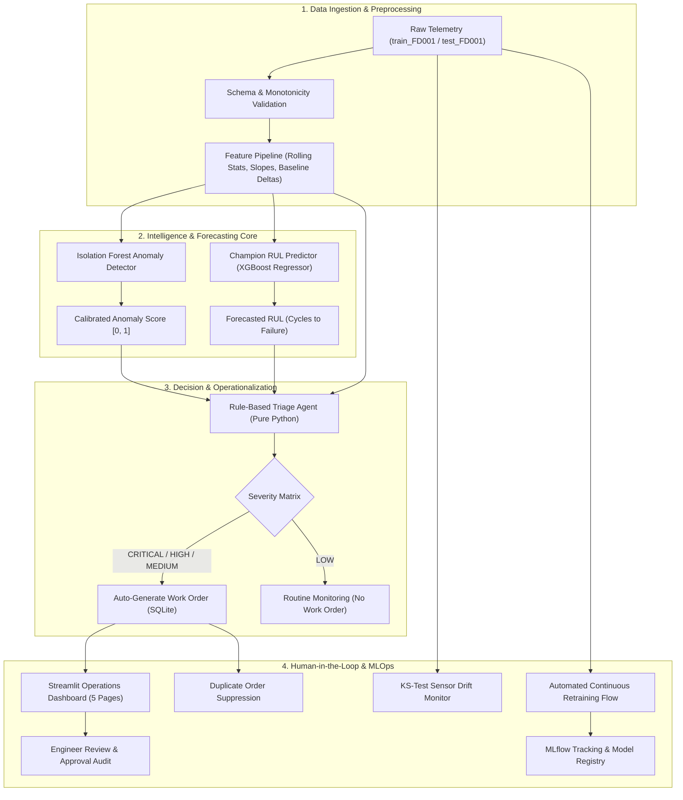

# NASA C-MAPSS Connected Fleet Predictive Maintenance System
### Teliport Season 4, Case Study 1 — "Self-Healing Machines: Predictive Maintenance for a Connected Fleet"

---

## 1. Executive Summary & System Overview

This project delivers a production-grade, closed-loop Proof of Concept (PoC) predictive maintenance system developed for **Teliport Season 4, Case Study 1**. Built on the **NASA Turbofan Engine Degradation Simulation benchmark (C-MAPSS FD001)**, the system transforms raw streaming sensor telemetry into explainable, automated, and traceable maintenance directives.

### Key Capabilities:
1. **Telemetry Ingestion & Leakage-Free Feature Engineering**: Computes rolling statistics, instantaneous rates of change, trend slopes, and engine-specific baseline deviations strictly using past observations.
2. **Unsupervised Anomaly Detection**: Isolation Forest model trained on early healthy engine regimes to establish baseline operational boundaries and output calibrated anomaly scores ($[0.0, 1.0]$).
3. **Multi-Model Remaining Useful Life (RUL) Benchmarking**: Evaluates and compares Linear Ridge, Random Forest, XGBoost Gradient Boosting, and a 2-layer PyTorch Temporal LSTM across both capped ($125$ cycles) and uncapped targets.
4. **Deterministic Rule-Based Triage Agent**: A pure Python decision engine (**no LLM, no external agent APIs**) combining forecasted RUL, anomaly severity, and critical aerospace sensor limits into standardized maintenance tiers.
5. **Closed-Loop Work Order Management**: SQLite-backed work order persistence featuring lifecycle management (`OPEN` $\rightarrow$ `IN_REVIEW` $\rightarrow$ `APPROVED` $\rightarrow$ `COMPLETED`) and duplicate work-order suppression.
6. **MLOps Lifecycle & Retraining**: Integrated with MLflow experiment tracking, model registry versioning (`v1.0.0`, `v2.0.0`), Kolmogorov-Smirnov sensor drift detection, and automated Champion-Challenger candidate retraining gates.
7. **Interactive Operations Dashboard**: A 5-page Streamlit monitoring dashboard providing fleet-wide health monitoring, deep-dive diagnostics, work order approvals, and live retraining triggers.

---

## 2. End-to-End System Architecture



---

## 3. Dataset Characteristics & Thermodynamic Failure Physics

### Dataset Breakdown (`FD001`):
* **Source**: NASA Prognostics Center of Excellence (A. Saxena et al., PHM 2008).
* **Operating Conditions**: **ONE** condition (Sea Level Cruise).
* **Fault Mode**: **ONE** fault mode (High-Pressure Compressor / HPC Aerodynamic Wear).
* **Fleet Volume**: 100 training engines (run to catastrophic failure, 20,631 total cycles); 100 test engines (trajectories truncated prior to failure, 13,096 cycles).
* **Sensor Variance**: 7 invariant/flat sensors (`s1`, `s5`, `s6`, `s10`, `s16`, `s18`, `s19`) and 14 active degrading sensors.

### Thermodynamic Degradation Mechanics:
The root fault is blade erosion and tip clearance widening in the High-Pressure Compressor (HPC), causing a drop in adiabatic efficiency ($\Delta \eta_{HPC}$) and flow capacity ($\Delta C_{HPC}$).

Because the engine's closed-loop controller (FADEC) maintains requested sea-level thrust, it compensates by burning more fuel and spinning the rotors faster. This yields distinct physical sensor signatures:

| Sensor | Symbol | Physical Measurement | Baseline | Failure | $\Delta$ | Drift Direction | Failure Mechanism |
| :--- | :--- | :--- | :---: | :---: | :---: | :---: | :--- |
| **`sensor_11`** | $Ps_{30}$ | HPC Static Pressure | $47.35\text{ psia}$ | $48.13\text{ psia}$ | $+1.66\%$ | **$\uparrow$ DRIFT UP** | Core flow restriction lowers axial velocity, building static backpressure at combustor entry ($r = -0.696$). |
| **`sensor_4`** | $T_{50}$ | LPT Outlet Temp (EGT) | $1402.6^\circ\text{R}$ | $1428.7^\circ\text{R}$ | $+1.86\%$ | **$\uparrow$ DRIFT UP** | Direct indicator of thermal stress; higher fuel burn elevates exhaust gas temperatures ($r = -0.679$). |
| **`sensor_12`** | $\phi$ | Fuel Flow to $Ps_{30}$ Ratio | $521.9\text{ pps/psia}$ | $519.8\text{ pps/psia}$ | $-0.40\%$ | **$\downarrow$ DRIFT DOWN** | Fuel metering ratio drops as static backpressure rises ($r = +0.672$). |
| **`sensor_7`** | $P_{30}$ | HPC Total Pressure | $554.0\text{ psia}$ | $551.5\text{ psia}$ | $-0.44\%$ | **$\downarrow$ DRIFT DOWN** | Worn HPC blades can no longer sustain full dynamic pressure rise ($r = +0.657$). |
| **`sensor_15`** | $BPR$ | Bypass Ratio | $8.42$ | $8.52$ | $+1.21\%$ | **$\uparrow$ DRIFT UP** | Core aerodynamic choking diverts incoming fan airflow into the outer bypass duct ($r = -0.643$). |
| **`sensor_21`** | $W_{32}$ | LPT Coolant Bleed | $23.36\text{ lbm/s}$ | $23.07\text{ lbm/s}$ | $-1.24\%$ | **$\downarrow$ DRIFT DOWN** | Reduced core pressure gradients starve turbine blade cooling air passages ($r = +0.636$). |
| **`sensor_20`** | $W_{31}$ | HPT Coolant Bleed | $38.94\text{ lbm/s}$ | $38.45\text{ lbm/s}$ | $-1.25\%$ | **$\downarrow$ DRIFT DOWN** | Same mechanism; turbine blade overheating risk compounds as coolant flow drops ($r = +0.629$). |

---

## 4. Machine Learning & Model Benchmarking

### Target Strategy: Piecewise Linear Capped RUL (125 Cycles)
During early engine operation, initial component wear is within nominal design margins and does not correlate with time-to-failure. Modeling RUL as an unbounded linear countdown forces algorithms to predict differences between cycle 10 and cycle 50 where no physical degradation signal exists. 

Capping training targets at **$RUL_{cap} = 125$ cycles** focuses model capacity on the true degradation trajectory, dramatically reducing late prediction penalties.

### NASA Asymmetric Scoring Function
In aerospace fleet operations, predicting failure *later* than actual is far more dangerous than predicting failure *earlier*:
$$d_i = \hat{y}_i - y_i \quad (\text{Predicted RUL} - \text{True RUL})$$
$$s_i = \begin{cases} e^{-d_i / 13} - 1 & \text{if } d_i < 0 \text{ (Conservative early forecast)} \\ e^{d_i / 10} - 1 & \text{if } d_i \ge 0 \text{ (Risky late forecast penalty)} \end{cases} \quad \implies \quad S = \sum_{i=1}^N s_i$$

### Multi-Model Benchmark on Official Test Set (100 Test Engines)

| Model Name | Target Strategy | Validation RMSE | Validation MAE | Official Test RMSE | Official Test MAE | NASA Score ($S$) | Train Time (s) | Model Selection Status |
| :--- | :---: | :---: | :---: | :---: | :---: | :---: | :---: | :---: |
| **XGBoost Regressor** | **Capped (125)** | **51.02** | **32.56** | **14.11** | **10.33** | **269.35** | **0.80s** | 🏆 **PROMOTED CHAMPION (v1.0.0)** |
| **Random Forest Regressor** | Capped (125) | 51.37 | 32.80 | 14.37 | 10.48 | 304.98 | 10.16s | Benchmark Candidate |
| **Linear Ridge Baseline** | Capped (125) | 52.74 | 35.38 | 18.22 | 14.52 | 533.10 | 0.02s | Linear Tabular Baseline |
| **PyTorch Temporal LSTM** | Capped (125) | 50.40 | 32.23 | 19.68 | 14.94 | 729.67 | 53.65s | Sequence Deep Learning |
| **XGBoost Regressor** | Uncapped | 34.27 | 24.07 | 23.57 | 16.52 | 10,294.26 | 1.50s | Experimental Uncapped |

> **Key Finding**: Capped XGBoost achieved the best official test performance (**Test RMSE: 14.11, NASA Score: 269.35**), outperforming the deep learning LSTM on tabular time series while training in under 1 second. The uncapped model yielded an astronomical NASA score ($10,294$) due to severe late-prediction penalties on early-life test engines.

---

## 5. Unsupervised Anomaly Detection

C-MAPSS does not provide ground-truth binary anomaly labels for every operational cycle. To maintain methodological rigor:
1. **Nominal Envelope Training**: An `IsolationForest` ($100$ estimators, $10\%$ contamination) is trained on early baseline cycles ($t \le 30$) across all training engines to define the normal operating hypersphere.
2. **Calibrated Anomaly Scores**: Raw decision function outputs are inverted and min-max scaled into a calibrated score $A \in [0.0, 1.0]$:
   * $0.00 \le A < 0.40$: Nominal cruise telemetry.
   * $0.40 \le A < 0.55$: Moderate telemetry drift.
   * $0.55 \le A < 0.70$: High anomaly (alert triggered).
   * $A \ge 0.70$: Critical out-of-envelope deviation.
3. **Correlation with Degradation**: Across all fleet engines, anomaly scores remain flat ($\approx 0.05\text{--}0.15$) during healthy life, then sharply inflect at the degradation knee point ($RUL \approx 50\text{--}70$ cycles), reaching $>0.85$ near failure.

---

## 6. Deterministic Rule-Based Triage Agent

The Triage Agent complies strictly with the competition requirement: **pure Python logic with zero LLM or cloud agent dependencies**.

### Decision Matrix:
```
           RUL <= 15 OR Anomaly >= 0.70
                     │
                    YES ──► [CRITICAL] Ground Engine Immediately for Hot-Section Overhaul
                     │
                    NO
                     │
           RUL <= 40 OR Anomaly >= 0.55
                     │
                    YES ──► [HIGH] Prioritize Maintenance within Next Scheduled Flight Rotation (<5 Cycles)
                     │
                    NO
                     │
           RUL <= 80 OR Anomaly >= 0.40
                     │
                    YES ──► [MEDIUM] Schedule Workshop Boroscope Inspection & Closely Monitor Trend
                     │
                    NO
                     │
                     ▼
           [LOW] Routine Continuous Monitoring (Nominal Operating Envelope)
```

### Safety & Override Rules:
* **Low RUL Override**: Even if the anomaly detector reports "NORMAL", an engine with $RUL \le 40$ is automatically escalated to HIGH or CRITICAL.
* **High Anomaly Override**: Even if predicted RUL is $>80$, an anomaly score $\ge 0.55$ forces a MEDIUM or HIGH inspection order.
* **Sensor Threshold Safeguards**: If exhaust gas temp $T_{50} \ge 1425.0^\circ\text{R}$ or static pressure $Ps_{30} \ge 48.0\text{ psia}$, explicit engineering warnings are appended to the decision rationale.

---

## 7. Closed-Loop Maintenance Work Orders (SQLite)

Work orders are managed via `src/maintenance/work_orders.py` and persisted in `data/work_orders.db`.

### Database Schema:
* `work_order_id`: Unique identifier (e.g. `WO-ENG034-20261101-9B2E1A`).
* `engine_id`: Target unit ID.
* `predicted_rul`: Model forecast at time of triage.
* `severity`: `CRITICAL`, `HIGH`, `MEDIUM`.
* `anomaly_status`: `NORMAL` or `ANOMALY`.
* `anomaly_score`: Calibrated isolation score.
* `important_sensors`: JSON snapshot of critical telemetry ($T_{50}, Ps_{30}, P_{30}, BPR$).
* `recommended_action`: Plain-text directive.
* `reason`: Full diagnostic justification.
* `model_version`: Tag of the inferencing model (e.g. `v1.0.0`).
* `status`: `OPEN` $\rightarrow$ `IN_REVIEW` $\rightarrow$ `APPROVED` $\rightarrow$ `COMPLETED` (or `CANCELLED`).
* `reviewed_by` / `reviewer_notes` / `updated_at`: Audit trail for human maintenance approval.

### Duplicate Order Prevention:
Before creating an order, the system queries for existing open orders for that engine in `OPEN`, `IN_REVIEW`, or `APPROVED` status. If an active work order exists, the existing record is returned without inserting duplicates.

---

## 8. Continuous MLOps Lifecycle

1. **Experiment Tracking**: Integrated with **MLflow** (`sqlite:///mlflow.db`) logging parameters, runtimes, validation metrics, test metrics, and serialized artifacts.
2. **Model Registry & Rollback**: `models/model_catalog.json` tracks model versions (`v1.0.0`, `v2.0.0`), deployment timestamps, and champion/challenger statuses. Rollback to any prior version is supported via `registry.rollback_to_version("v1.0.0")`.
3. **Data Drift Detection**: Automated two-sample **Kolmogorov-Smirnov (KS) test** across all 14 active sensors comparing incoming fleet telemetry against baseline training distributions.
4. **Champion-Challenger Retraining**:
   * Simulates newly completed engine runs.
   * Trains candidate Challenger model.
   * Evaluates on held-out validation data.
   * **Acceptance Gates**: Promotes to Champion only if Candidate $RMSE \le \text{Threshold}$ ($25.0$) and Candidate $RMSE \le \text{Champion } RMSE \times 1.05$. Otherwise, registers as an archived candidate.

---

## 9. 3 Illustrative Real-Data Engine Scenarios

From our live test fleet execution (`100` engines):

### Scenario A: Critical Flight Safety Risk (Unit 34)
* **Operating Cycle**: Cycle 203.
* **Forecasted RUL**: **5.3 cycles** (Ground Truth: 7 cycles; Error: $-1.7$ cycles).
* **Anomaly Score**: **0.92** (`ANOMALY`).
* **Telemetry Warnings**: $T_{50} = 1427.5^\circ\text{R} \ge 1425.0^\circ\text{R}$; $Ps_{30} = 48.13\text{ psia} \ge 48.0\text{ psia}$.
* **Assigned Severity**: `CRITICAL`
* **Recommended Action**: Ground engine immediately for priority inspection and hot-section overhaul.

### Scenario B: High Degradation Priority (Unit 41)
* **Operating Cycle**: Cycle 123.
* **Forecasted RUL**: **21.8 cycles** (Ground Truth: 18 cycles; Error: $+3.8$ cycles).
* **Anomaly Score**: **0.70** (`ANOMALY`).
* **Assigned Severity**: `HIGH`
* **Recommended Action**: Prioritize maintenance within next scheduled flight rotation / 5 cycles.

### Scenario C: Nominal Healthy Cruise (Unit 39)
* **Operating Cycle**: Cycle 37.
* **Forecasted RUL**: **125.0 cycles** (Ground Truth: 142 cycles).
* **Anomaly Score**: **0.06** (`NORMAL`).
* **Assigned Severity**: `LOW`
* **Recommended Action**: Routine continuous monitoring; engine operating within nominal design envelope.

---

## 10. How to Run the System

### Prerequisites:
```bash
pip install -r requirements.txt
```

### 1. Run Complete Test Suite (16 Automated Tests):
```bash
pytest tests -v
```

### 2. Run Reproducible End-to-End Demonstration:
```bash
python run_demo.py
```
*(Ingests 100 test engines, runs anomaly detection, predicts RUL, triggers Triage Agent, persists SQLite work orders, tests duplicate suppression, and runs a retraining cycle).*

### 3. Launch Interactive Streamlit Operations Dashboard:
```bash
python -m streamlit run dashboard/app.py
```

### 4. View Standalone HTML Telemetry Dashboard (Zero-Server):
```powershell
Start-Process .\cmapss_fd001_dashboard.html
```

---

## 11. Assumptions & Limitations

1. **Simulated vs. Real-World Telemetry**: The NASA C-MAPSS dataset is generated by a thermodynamic computer simulation of a 90,000-lb thrust turbofan engine. While it realistically models gas-path aerothermal dynamics, it does not represent ground transport vehicles (trucks, buses) or industrial refrigeration compressors.
2. **Proxy Anomaly Labels**: In the absence of per-cycle ground-truth fault flags, the anomaly detection module relies on unsupervised density estimation (Isolation Forest) trained on early healthy cycles ($t \le 30$).
3. **No Direct Physical Crack Measurement**: The model infers degradation solely from gas-path thermodynamic secondary effects (temperatures, pressures, rotor speeds), not direct structural non-destructive inspection (NDI) or vibration spectrum analysis.
4. **Human-in-the-Loop Safeguard**: Automated work orders are diagnostic decision-support tools. Certified aircraft maintenance engineers retain mandatory sign-off authority prior to executing physical overhauls.
